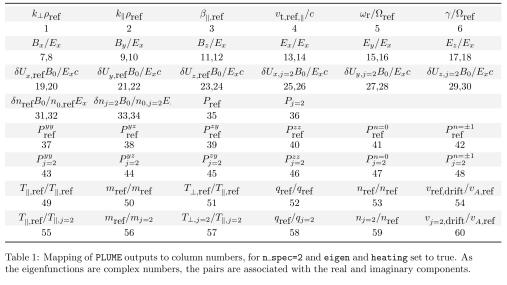
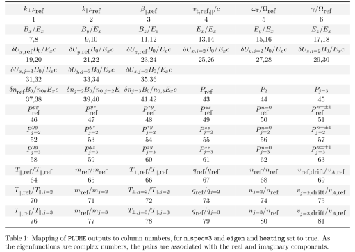
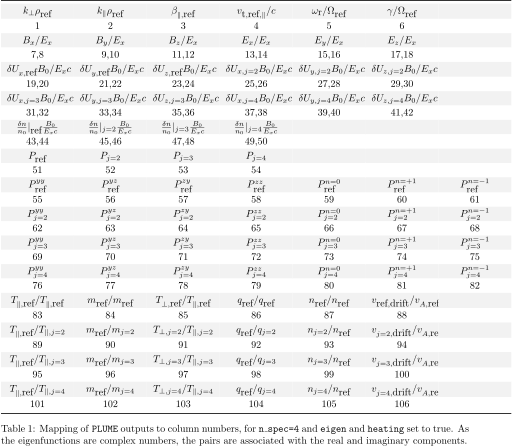

# PLUME Output

## Cold-reference mixed output (Stage 3B.2)

Supplied roots and frequency maps retain `omega/Omega_ref` and native `d_ref`
input units. The direct evaluator prints raw `det(Lambda)`, as for fully cold
runs. The normalization sidecar also records `auxiliary_first_warm_species`
and `b_star`, selected from its physical temperature; the exact-parallel limit
uses physical species thermal speeds directly. This metadata is not a change
to any physical input or a new user parameter.

`susc` stores the ordinary response for each species and `lam` stores the
complete wave matrix. Status 5 denotes unrepresentable/nonfinite arithmetic,
including auxiliary conversion or kinetic intermediates. Failure invalidates
all response arrays; isolated failed map samples stay NaN and are excluded from
candidate selection. No heating or species-moment values are fabricated. Stage 4B.1 now supplies electromagnetic fields.
See the [cold-reference report](tests/COLD_REFERENCE_MIXED_REPORT.md).

## Fully cold output (Stage 3A)

Fully cold `d_ref` runs use the same root/map layouts, frequency units,
status codes and failure recovery described below. The direct evaluator
(`option=-1`) prints **raw `det(Lambda)`**, explicitly labeled, because the
legacy thermal output scale is undefined at zero reference temperature.
The normalization sidecar records this distinction and the absence of thermal
reference scales. The Fortran `disp` API always returns the raw determinant.
Cold-containing diagnostic limitations apply to fully cold runs too.
See the [Stage 3A report](tests/FULLY_COLD_DISPERSION_REPORT.md).

## Mixed kinetic/cold output (Stage 2)

Mixed `d_ref` runs retain the frequency normalization `omega/Omega_R` and
ordinary species susceptibility `chi_s`. Supplied-guess runs (`option=1`,
`nscan=0`) print roots when `writeOut=.true.`. Frequency maps retain their numeric
layout and normalization sidecar. Singular/nonfinite map samples have NaN
determinant and log-magnitude fields, are excluded from root selection, and
produce a summary warning. Failed candidate refinements are omitted.

Direct evaluation (`option=-1`) retains the legacy printed determinant scaling
`det(Lambda)*solver_vtp**6` and adds a mixed status line: 0 valid, 1 invalid input,
2 zero frequency, 3 zero Doppler frequency, 4 cyclotron pole, 5 nonfinite numerical
result. The Fortran `disp` API returns the unscaled determinant; inspect
`vars::dispersion_status` before using its tensor arrays after a mixed call.
Failure invalidates `susc`, `lam`, and resonance arrays rather than leaving
stale values. A subsequent valid evaluation recomputes the physical response.

Mixed electromagnetic fields and species moments are available in Stages
4B.1/4B.2. Corrected collisionless wave energy/heating is supplied by Stage 4B.3A; FPC remains unavailable; the direct evaluator labels
those omissions and incompatible requests fail.
Cold resonance-resolved susceptibility entries (`susc_low`) are undefined/NaN,
not fictitious heating contributions. See the [Stage 2 report](tests/MIXED_DISPERSION_REPORT.md).

PLUME writes output solutions to the `/data` directory, to the subdirectory specified by `dataName`.
All output file names will have the `outputName` string included in the name to distinguish between distinct calculations. 

Numeric output columns contain values in the convention selected by
the input `normalization` parameter.
The first four columns of roots, modes, and tensor files are
`kperp`, `kpar`, `betap`, and `vtp` in **input units**:

- $k\rho_R$ and $v_{t\parallel,R}/c$ for `rho_ref`,
- or $kd_R$ and $v_{A,R}/c$ for `d_ref`.

Species `tauS` columns likewise contain the selected temperature definition.

The complex frequency always uses $\Omega_R$.
A `d_ref` run also writes `normalization_<outputName>.txt` beside its numeric outputs;
its absence in older outputs indicates the legacy `rho_ref` convention.
Reusing an output name with `rho_ref` removes a stale `d_ref` metadata file.
Existing numeric file column order and formatting are unchanged.

For the gyrotropic and Cartesian FPC files, velocities and fields continue to
use the kinetic solver's thermal velocity convention;
their headers describe those derived quantities.
The normalization metadata identifies the input convention used to generate the run.

## dispersion_*outputName*.map

Value of the dispersion tensor $\mathcal{\Lambda}(\omega_{\textrm{r}},\gamma)$ on a defined complex frequency grid.  
Solutions to the dispersion relation satisfy $|\mathcal{\Lambda}|  =0$.
This file is generated from the *map_search* subroutine in *disprels.f90*,
and invoked when `use_map` =.true. 

The data is ordered in columns as  
1. $\omega_r$  
2. $\gamma$   
3. $\log_{10} |\mathcal{\Lambda}|$  
4. Re $[|\mathcal{\Lambda}|]$  
5. Im $[|\mathcal{\Lambda}|]$  

The *&maps* namelist in *filename*.in determines the structure of *filename*.map.  
Linear grids span `omi` to `omf` with `nr` steps and `gami` to `gamf` with
`ni` steps (both endpoints included). `loggridw` and `loggridg` select
historical logarithmic equations whose bounds are **not physical endpoints**;
the imaginary logarithmic grid is always negative. See
[the exact equations and warning](input.md#historical-logarithmic-maps).
`nr` and `ni` are set to 128 as a default which can be replaced by user defined parameters;
see [input.md].

## dispersion_*outputName*.roots

Identified solutions to the dispersion relation $|\mathcal{D}|  =0$, calculated using *refine_guess* in *disprels.f90*.

The data is ordered in columns as:
1. $k_\perp \rho_{ref}$
2. $k_\parallel \rho_{ref}$
3. $\beta_{ref,\parallel}$
4. $v_{t,ref,\parallel}/c$
5. $\omega_{r}/\Omega_{ref}$
6. $\gamma/\Omega_{ref}$

This will be followed by 6`nspec` columns containing the parameter lists $\mathcal{P}_j$ for each species or component.
- $T_{ref,\parallel}/T_{j,\parallel}$.
- $m_{ref}/m_{j}$.
- $T_{j,\perp}/T_{j,\parallel}$.
- $q_{ref}/q_{j}$.
- $n_{j}/n_{ref}$.
- $v_{j,drift}/v_{A,ref}$.

Only the first `nroot_max` solutions will be identified and written to file.

## *outputName*_*param*_*range*.modeN

The dispersion relation calculated from `om_scan` will have different formats based upon the number of species as well as the suplementary calculations invoked.

The *param* name will be assigned based on the kind of parameter scan performed, specifically:

*`scan_style`=-1:*

- `k` for scan from $\textbf{k}_0 \rho_{ref}$ to $\textbf{k}_1 \rho_{ref}$ (`scan_type`=0).
- `theta` for scan from $\theta_0$ to $\theta_1$ with fixed $|k|\rho_{ref}$ (`scan_type`=1).
- `k_fixed_theta` for scan from $|k|_1\rho_{ref}$ to $|k|_1\rho_{ref}$ with a fixed value of $\theta$ (`scan_type`=2).

*`scan_style`=0:*

- `kperp` for scan of $k_\perp \rho_{ref}$ (`scan_type`=0).
- `kpar` for scan of $k_\parallel \rho_{ref}$ (`scan_type`=1).
- `beta` for scan of $\beta_{ref,\parallel}$ (`scan_type`=2).
- `vtp` for scan of $v_{t,ref,\parallel}/c$ (`scan_type`=3).

*`scan_style`=1-`nspec`:*

- `tauS` for scan of $T_{ref,\parallel}/T_{j,\parallel}$ (`scan_type`=0).
- `muS` for scan of $m_{ref}/m_{j}$ (`scan_type`=1).
- `alphS` for scan of $T_{j,\perp}/T_{j,\parallel}$ (`scan_type`=2).
- `qs` for scan of $q_{ref}/q_{j}$ (`scan_type`=3).
- `Ds` for scan of $n_{j}/n_{ref}$ (`scan_type`=4).
- `Vs` for scan of $v_{j,drift}/v_{A,ref}$ (`scan_type`=5).

The initial and final values of the parameter scanned over will be reflected in the *range* portion of the file name.

One file for each mode followed will be produced.

The first six columns are the same regardless of supplemental calculations,
normalized to the appropriate convention.
They are ordered as
1. $k_\perp L_{ref}$
2. $k_\parallel L_{ref}$
3. $\beta_{ref,\parallel}$
4. $v_{t,ref,\parallel}/c$ or $v_{A,ref}/c$
5. $\omega_{\textrm{r}}/\Omega_{ref}$   
6. $\gamma/\Omega_{ref}$

If `eigen` is set to true, the next set of columns will be the eigenfluctuations, with fields normalized to $E_x$, velocity normalized to $c E_x/B_0$ and density normalized to $n_{0s} E_x/B_0$, 

7. Re $[B_x]$   
8. Im $[B_x]$   
9. Re $[B_y]$   
10. Im $[B_y]$   
11. Re $[B_z]$   
12. Im $[B_z]$   
13. Re $[E_x]$   
14. Im $[E_x]$   
15. Re $[E_y]$   
16. Im $[E_y]$   
17. Re $[E_z]$   
18. Im $[E_z]$   
19. [+6(j-1)] Re $[\delta U_{x,j}]$   
20. [+6(j-1)] Im $[\delta U_{x,j}]$   
21. [+6(j-1)] Re $[\delta U_{y,j}]$   
22. [+6(j-1)] Im $[\delta U_{y,j}]$   
23. [+6(j-1)] Re $[\delta U_{z,j}]$   
24. [+6(j-1)] Im $[\delta U_{z,j}]$   
19. [+6(`nspec`)+2(j-1)] Re $[\delta n_{j}]$   
20. [+6(`nspec`)+2(j-1)] Im $[\delta n_{j}]$ 

where `j` ranges from 1 to `nspec`.
The normalization follows Eqns. 33-37 in [Klein, K. G., Howes, G. G.,
and Brown, C. R., 2025](https://iopscience.iop.org/article/10.3847/2515-5172/add1c2)

If `heat` is set to true, the next set of columns will be the power absorption or emission from each component. If `low_n` is set to true, additional terms associated with Landau, Transit time, and Cyclotron heating will be output. If `eigen` is false, this data will start in the 7th column. If `eigen` is true, this data will start in the 18+8 `nspec`+1st column.

If `low_n` is true, all species totals `Ps(1:nspec)` appear first, then
seven consecutive channels for each species in original order.
Use zero-based `start = 18 + 8*nspec` when eigen=true, otherwise `start = 6`.
Total for species j (one-based species index) is column `start+j` (one-based
column). Channel c=1..7 is column `start+nspec+7*(j-1)+c`.
Channels are n=0 yy, yz, zy, zz, full n=0, transverse n=+1, transverse n=-1.
They are selected diagnostics, not an exhaustive partition: first four sum to
channel 5; channels 5--7 need not sum to Ps; summing all seven double-counts n=0.

This will be followed by 6`nspec` columns containing the parameter lists $\mathcal{P}_j$ for each species or component. 
- 19+`noutperspec` `nspec`+6(j-1)-12({!eigen}). $T_{ref,\parallel}/T_{j,\parallel}$.
- 20+`noutperspec` `nspec`+6(j-1)-12({!eigen}). $m_{ref}/m_{j}$.
- 21+`noutperspec` `nspec`+6(j-1)-12({!eigen}). $T_{j,\perp}/T_{j,\parallel}$.
- 22+`noutperspec` `nspec`+6(j-1)-12({!eigen}). $q_{ref}/q_{j}$.
- 23+`noutperspec` `nspec`+6(j-1)-12({!eigen}). $n_{j}/n_{ref}$.
- 24+`noutperspec` `nspec`+6(j-1)-12({!eigen}). $v_{j,drift}/v_{A,ref}$.
Here `noutperspec` is 0 if both flags are false, 8 if only one is true, and 16 if both are true (low_n=true). Note that {!eigen} (negation of eigen boolean) is equal to 1 if eigen is false and 0 if eigen is true.

For ease of reference, consider the below tables for column numbers for two and three component calculations.
   






This same data structure is preserved for the output from `om_double_scan`.
The file naming convention will include a value of *param* from both of the two parameters scanned, and the code will not output information about the range of parameters in the file name.


## Bessel harmonic metadata

Normal executable completion writes
`data/<dataName>/<outputName>.bessel`, without changing numeric mode, root,
tensor, heating or FPC file layouts. It records harmonic mode, tolerance,
adaptive maximum, fixed count, and whether unresolved truncation was encountered.
With `bessel_diagnostics=.true.`, or whenever an unresolved adaptive sum occurred,
it includes:

- Species index and physical Bessel argument.
- Active maximum absolute harmonic order and allocated capacity (which can be larger).
- Convergence status and upper bounds for ordinary and quadratic-weighted tails.
- Cache hits, misses and coefficient-array evaluations, counted per species slot.
- History of capped adaptive requests, including those preceding a later resolved point.

A miss can require selection only: a changed tolerance may reuse previously
computed coefficients. An array evaluation calculates all required Bessel
coefficients together, not one coefficient. Density, drift, parallel wavevector,
frequency and auxiliary scale do not enter the physical cache key. Exact argument
matching is used; no approximate matching tolerance is applied. A species-count
change preserves surviving slots, while a different argument in a reordered slot
requires recalculation. No on-disk cache is read.

Fixed 128 preserves its historical evaluators and caches; detailed hit/miss
instrumentation is unavailable for that compatibility path and is labeled as
such. Its final-point tail bounds still determine the `unresolved` flag.
Analytical parallel and fully cold paths allocate no adaptive Bessel arrays.
`unresolved=F` describes truncation only, not a bound on total numerical error.
For standalone library/probe callers, `finish_bessel_diagnostics()` writes the
sidecar and `bessel_cache::write_bessel_stats(unit)` provides the table directly.


## Collisional longitudinal diagnostics

The collisional `zz` susceptibility and its `susc_low` entries for n=0,+1,-1
now use the corrected longitudinal Krook response. Collisional roots, fields
and heating derived from that response can change. The correction is independent of the selected Z backend.
The signed `zz` diagnostics contain each harmonic's full nonresonant terms;
the bulk sum separately regroups the drift contribution. For a truncated sum,
reconstruction must include the drift remainder proportional to
`1-Gamma_0-2*sum(Gamma_n)`, rather than adding another full drift term.
See the [derivation and validation report](tests/COLLISIONAL_ZZ_CORRECTION.md).


## Plasma dispersion backend metadata and failures

With `writeOut=.true.`, input validation prints `Z backend: faddeeva` or
`Z backend: legacy` once. Bessel sidecars append `# z_backend=<mode>` without
changing the existing numerical table rows. No new columns are added to numeric
root, tensor, eigenfunction or heating output files.

The accurate backend returns invalid determinants/tensors on nonfinite or
out-of-range evaluation, with the existing dispersion failure status. Failed
root trials are rejected; isolated invalid map points are excluded from minima
searches and retained as invalid values in map output. A subsequent valid trial
can succeed normally. Direct single-frequency failures skip supplementary
diagnostics. Compatibility mode preserves historical Z failure behavior.
See [backend selection](input.md#plasma-dispersion-function-backend) and the
[validation report](tests/FADDEEVA_BACKEND_REPORT.md).


## Mixed wavevector scan output (Stage 4A)

The existing `.modeN` and optional susceptibility-tensor layouts are unchanged.
Root-only rows are `kperp, kpar, betap, vtp, omega_r, omega_i`, followed by
`tauS, muS, alphS, Qs, Ds, vvS` for each species in input order (6+6*nspec
real columns). The coordinate and parameter values use the selected input
normalization. Frequencies remain `omega/Omega_ref`. Existing mode files retain
six decimal places in scientific mantissas; `.roots` maps retain their existing
lower precision. No columns are reordered, added, or silently repurposed.

Failure rows contain NaN frequencies and invalid tensor/diagnostic values rather
than stale results. The physical coordinate/parameter columns remain present.
Warnings identify failed attempts, including intermediate steps suppressed by
`nres`. The next point uses the last successful seed. A recovery can land on a
different branch after a large gap; a finite residual alone does not identify
the branch. Inspect frequency continuity and refine steps where necessary.

`option=2` retains blank-line grid separators. `option=4` retains one `.map` and
`.roots` pair per wavevector, with independent root selection. Cold-containing
maps use the supplied frequency bounds. Existing normalization and Bessel cache
metadata remain available, with their established Z/backend labels. No new columns are introduced. Stage 4B.1 fills the existing electromagnetic
field columns; Stage 4B.2 also fills density/velocity slots for cold-containing runs.

See the [scan input guide](input.md#mixed-wavevector-scans-stage-4a) and
[validation report](tests/MIXED_SCAN_REPORT.md).


## Electromagnetic eigenfunction conventions (Stage 4B.1)

The existing eigen layout and scientific precision are preserved. Columns 7–12
are complex Bx,By,Bz, and 13–18 are complex Ex,Ey,Ez, with real/imaginary pairs.
The first six root/input columns and trailing six species parameters per species
retain their meanings. Eigen-only files have `18+14*nspec` real columns.

Stage 4B.2 fills the intervening `8*nspec` velocity/density values (starting at
column 19) for cold and warm species, in their original ordering. Failed species
moment blocks contain NaN, rather than physical zeros. Existing all-kinetic
moments and heating layouts/calculations are unchanged. Python `load_plume_sweep`
reads these files using `eigen=True, heating=False`; NaNs are retained.

The gauge is Ex=1+0i. E and B are divided by the same physical deltaEx amplitude
in Gaussian units. Hence omega_hat*B=(k_d/(v_A/c)) cross E in d_ref, and
omega_hat*B=(k_rho/(vtp*sqrt(alpha_ref))) cross E in rho_ref. Auxiliary b_star
is absent from physical polarization and amplitudes. The complex frequency,
not only its real part, enters this relation. For component ratios compare
complex Ey/Ex, Ez/Ex or B ratios; a common phase/amplitude must be removed when
comparing to independently normalized eigenvectors. For example the derived
transverse circular-polarization measure
`2*Im(Ex*conjg(Ey))/(abs(Ex)**2+abs(Ey)**2)` keeps its existing sign convention;
Ey=-i Ex gives +1. No new scalar polarization columns are added.

A failed or unavailable field solution fills all E/B slots with NaN and emits
a status warning; root and species susceptibility information remain usable
when the dispersion evaluation itself succeeded. In particular Ex=0 modes
cannot be represented without changing the historical gauge. Degenerate
polarizations are not assigned an arbitrary vector. No numerical floor is
used to replace zero wavevector components or normalize a zero Ex.

The single-point cold/mixed evaluator prints the existing `ef`/`bf` blocks at
a valid mode, and a status/omission notice elsewhere. It does not print fabricated
energies. It now also prints species moments and their statuses. The
normalization sidecar identifies field/moment units, species models, and
unavailable diagnostics. Read the
[implementation/validation report](tests/MIXED_EIGENFUNCTION_REPORT.md) for
cofactor pivoting, failure statuses, tolerances, and the energy assessment.


## Species moment conventions (Stage 4B.2)

Existing eigen-only files retain `18+14*nspec` real columns:

- 1–6: native kperp, kpar, betap, vtp, complex frequency;
- 7–18: Bx,By,Bz and Ex,Ey,Ez as real/imaginary pairs;
- 19 through `18+6*nspec`: Ux,Uy,Uz real/imaginary pairs for species 1, then 2, etc.;
- `19+6*nspec` through `18+8*nspec`: density real/imaginary pairs in species order;
- the remaining `6*nspec` columns: existing plasma/species input parameters.

No columns are inserted, removed or repurposed. Velocity is
`deltaU_s/(c*deltaEx/B0)`; density is `(delta n_s/n0_s)/(deltaEx/B0)`.
These use the same historical Ex=1 amplitude/phase convention as E/B. To obtain
physical values, choose the wave amplitude deltaEx/B0, multiply the velocity
by c times that amplitude, and density by n0_s times that amplitude.
The full complex omega enters momentum and continuity.

Exactly zero tauS selects cold-fluid moments; positive tauS selects kinetic
current/continuity moments. Neither an assumed species ordering nor auxiliary
thermal normalization changes these physical units. The density-drift current
must be retained when converting moments to current for drifting species.
Cold anisotropy placeholders are ignored.

NaN means unavailable, including numerical failure or absent zero-density
species. A failed species does not invalidate other species or successful E/B.
Warnings identify the species and status; single-point output also lists the
per-species statuses. The normalization sidecar records species model, units,
and status meanings. Corrected heating/wave energy is described below; cold-containing FPC remains excluded. The Python loader uses `eigen=True, heating=False` and
reads finite moments or NaNs in the unchanged columns.

See [input/API and status codes](input.md#species-moments-stage-4b2) and
[the independent moment validation report](tests/COLD_FLUID_EIGENFUNCTION_REPORT.md).


## Corrected energy companion (plume-energy-v1)

The existing low_n=true mode-file numeric columns/precision are unchanged.
Heating values change by default to the corrected convention. Cold species
and failed/inapplicable heating have NaNs, preserving every species slot.
Historical `Ew` values were unassigned and are not wave energy. In corrected
low_n=false eigen+heating output that old final slot is explicitly NaN;
heating-only no longer writes an orphan unassigned Ew record. New H components
are never inserted into the old heating blocks or substituted into Ew.

Corrected `option=-1`, and serial/2D scans requesting heating, write
`data/<dataName>/<outputName>.energy`. Single-point/scan runs reset their prior companion;
legacy writes none. Maps are unchanged. Header `schema=plume-energy-v1`
version-controls a whitespace table. `# columns:` specifies every column;
the final quoted `source_file` tolerates spaces. Each row identifies the
workflow (-1 single, 1 serial, 2 grid), scan, outer/point iteration indices,
mode, root/field validity, numerical status and applicability. Indices use
the existing scan loops: point is the integration index, **not** the output
row number when nres>1. Missing/failed roots have explicit rows, NaNs and
status 8; they do not shift later mode associations. The source mode file,
wavevector, outer index and point identify each output unambiguously.

Numeric columns are 11 integers followed by 16 reals, then 15 reals/species:

```
record workflow scan outer point mode root_valid field_status
energy_status applicability response_code
kperp kpar omega_r gamma H_total H_E H_B H_species_total
f_E f_B f_species f_E_abs uncertainty gamma_ratio gamma_est total_Ps
# repeated for s=1..nspec:
H_s f_s Q_s Ps_s status_s dmatrix_s dproject_s dstep_s C1_s ... C7_s
# final string:
source_file
```

Wavevectors use native input units; w/gamma use Omega_ref. H terms have units
`16*pi*W/abs(deltaEx)^2`. Hs differentiates wr*chi_H at fixed physical plasma
and k. E is Ex=1 at the accepted complex mode; HB uses real wr Faraday fields,
not the old complex-frequency magnetic norm. All susceptibility snapshots for
Q and the seven channels share that same wr. Q is raw signed absorption,
Ps=Q/H. C1..C7 are the seven normalized channels, +1 preceding -1.
`total_Ps` sums kinetic Ps only when every required diagnostic is available;
fully cold or qualified/failed values are NaN, not a physical zero.

`f_E=H_E/H`, `f_B=H_B/H`, `f_species=sum(Hs)/H`, `f_s=Hs/H` are **signed formal
fractions**, unclamped; negative-energy/drifting modes can have fractions
outside [0,1]. They sum to one when resolved. If H is within ten estimated
numerical uncertainties of zero, signed fractions and normalized heating are
unavailable. `f_E_abs=H_E/(abs(H_E)+abs(H_B)+sum(abs(Hs)))` is a noncancelling
**contribution measure**, not a physical energy fraction, and can remain
available when signed fractions are not. No artificial floor is inserted.

`uncertainty` estimates derivative step-window and floating-point error,
not a rigorous bound or a physical applicability guarantee. `dmatrix_s` and
`dproject_s` report neighboring Richardson estimate changes, with a shared
conservative scale; both must pass 1e-6. `dstep_s` is the chosen relative
centered step. Cold derivatives are analytic (step/errors zero).

| Code | energy_status |
|---|---|
| 0 | Numerically resolved formal energy |
| 1, 2, 3 | Invalid input, unavailable Ex=1 fields, zero wr |
| 4, 5, 6 | Response/pole failure, unresolved derivative, unresolved H |
| 7, 8, 9 | Unsupported collisions, failed root, arithmetic failure |

Applicability is a bit mask: 1 for abs(gamma/wr)>0.05; 2 for weak balance
mismatch/near-reactive warning. Formal energy may remain resolved with either
bit; kinetic Ps/channels are then NaN. `gamma_est=-wr*sum(Q_kinetic)/H` is an
independent weak-mode check, not an imposed closure or strong-mode growth rate.
Species status: 0 valid kinetic, 1 cold kinetic-heating unavailable, 2 absent,
3 response/input failure, 4 unresolved derivative, 5 unavailable normalizer,
6 applicability. Cold Hs/f_s are still calculated when energy is resolved.
Response codes retain existing kernel pole/numerical status definitions.

Read using `linfpclib.linfpc.load_plume_energy(path)`. It returns named NumPy
columns plus raw `metadata`, retaining failed records and NaNs. The existing
low_n=true `load_plume_sweep` now uses the correct heating offset and seven-
channel stride; original Fortran column meanings are unchanged. Its automatic
schema inference remains ambiguous for some species/flag combinations: supply
nspec/eigen/heating explicitly. For low_n=false use the companion or explicit
schema; the historical sweep reader assumes seven channels.

### Explicit contour-reader schemas and FPC missing values

`contours.plot_plume_resonances.read_dispersion_output(path, input, branch)`
uses the matching input's `eigen`, `heating`, `low_n`, and species count.
It validates the exact scan column count; species-parameter columns are never
inferred to be heating. Serial files with different scan diagnostic flags
require the one-based keyword `scan_index=N`. Two-dimensional files use
`scan_input_2` flags, as the writer does. Eigen-only, heating-only, and combined
files retain their original species ordering and seven-channel ordering.
Mismatched/ambiguous layouts raise `ValueError`. Historical ragged
`low_n=false` records are rejected explicitly; rectangular records with
explicit flags can be read. No Fortran record format is changed.

Gyro and Cartesian FPC readers in `linfpclib.linfpc` preserve NaN, infinity,
finite positive/negative values, physical zeros, and array shape by default.
The Cartesian 3D reader also preserves representable small/large samples
without the old clipping. Existing FPC units, normalization, and calculation
restrictions are unchanged. To replace **only NaNs** with zeros for a plot,
explicitly pass `visualization_nan_to_zero=True`; this does not convert
infinities or reinterpret unavailable values as calculated physical zeros.
The option is also available through distribution-loading helpers. The
`.energy` reader is unchanged and continues to retain missing/failed records.
