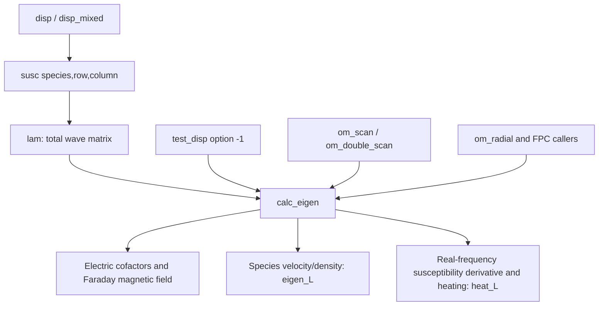

# Stage 4B.1: electromagnetic eigenfunctions and polarization

## Milestone 1 audit (written before production changes)

The existing `disprels::calc_eigen` is the implementation to preserve, not a
missing eigenfunction solver. Its call paths are:



`disp0`, `disp1`, `disp_mixed_parallel` and the native `disp_all_cold` assembler
all store ordinary species susceptibilities separately in `susc(s,i,j)` and
assemble `lam=I+sum(chi_s)+n*n^T-n^2*I`. Cold-reference mixtures use the latter
native assembly after the auxiliary kinetic kernel. No electromagnetic
polarization should substitute a thermal-reference tensor for this total matrix.

| Class | Existing outputs/dependencies | Decision for this stage |
| --- | --- | --- |
| A: electromagnetic | `electric(1:3)`, `magnetic(1:3)`; Cartesian B0 along z, k=(kperp,0,kpar); only lam, omega and refractive wavevector needed | Reuse existing cofactor algebra and Faraday conversion; extend to cold compositions |
| B: total energy | local `ewave` in calc_eigen heat_L block; real-frequency Hermitian susceptibility derivative plus magnetic norm | Do not enable for mixed/cold: applicability and exported normalization are not established |
| C: species energy | `susca`, species quadratic forms `Ps`, harmonic `susc_low` projections; normalized by that same ewave | Heating/transfer definition, not an independent supported species-energy output; deferred |
| D: moments/heating/FPC | `vmean`, `ns`, `Ps`, `Ps_split`; species density/charge/drift, solver_betap/vtp, thermal reference scales and harmonic data | Leave all-kinetic path unchanged; unavailable for all species in mixed/cold runs in 4B.1 |

The field method sets Ex=1+0i and solves two wave-matrix rows using 2x2 minors.
It is a cofactor elimination, not a general eigensolver. Its chosen divisor
lam(3,2) vanishes at exact parallel propagation, although the transverse mode
has a perfectly usable Ex=1 polarization. Pivoting among equivalent row-pair
cofactors addresses that implementation restriction. A truly Ex=0 mode cannot
be expressed in the historical gauge. Such modes (e.g. the exactly perpendicular
cold O mode) must be reported unavailable rather than assigned a new amplitude
normalization. Rank-deficient/degenerate and off-mode matrices also need explicit
failure handling.

`calc_eigen` reads solver_* aliases. Its electric block uses only lam, but its
magnetic conversion uses k_rho/(w*vtp*sqrt(alpha_ref)). This is correct for the
historical perpendicular thermal gyroradius. In Gaussian field units Eout=deltaE/
deltaEx and Bout=deltaB/deltaEx; Faraday gives

\[
 w B_{out}=K/(v_{t,parallel,R}/c\sqrt{alpha_R})\times E_{out}
          =\kappa/(v_{A,R}/c)\times E_{out}.
\]

Here K=k*rho_R, kappa=k*d_R, w=omega/Omega_R. In warm-reference d_ref,
K=kappa*sqrt(beta_R*alpha_R) and vtp_solver=(vA/c)*sqrt(beta_R), so both thermal
factors cancel. For cold-reference inputs use native kappa/(vA/c) directly.
The auxiliary b_star and auxiliary anisotropy never enter physical field
normalization. Cartesian ordering and the exp(i*k.r-i*omega*t) convention remain
unchanged. The SI physical Faraday equation has no c; PLUME's Gaussian field
ratios and normalized wavevectors supply the displayed factors.

Energy audit: `dsusch` approximates d[omega*chi_H]/domega at real(omega), with
forward relative step 1e-6. `ewave=E^dagger*dsusch*E+|B|^2` omits the vacuum
|E|^2 term that would arise from differentiating epsilon rather than chi. It is
local to heating and is not returned. Separate caller variables named `Ew`
are not assigned by calc_eigen, despite appearing in some old heating layouts.
This prevents validating an exported exact total energy, particularly for
complex-frequency modes. No new energy definition or correction is attempted;
legacy calculations remain unchanged and new mixed/cold energy is disabled.

Integration plan: share the literal electric cofactor statements; keep the
legacy kinetic field/moment/heating execution path and arithmetic. A separate
precise module will use the same field method, equivalent cofactor pivots,
physical normalization and explicit status codes. It will refresh through the
existing dispersion callback, retain all species responses, and never construct
cold thermal scales. Existing scan eigen columns will contain E/B followed by
NaN unavailable species moments; heating remains rejected. Existing column order
and precision stay intact. Purely electromagnetic single-point/API and serial/
2D scan outputs will be independently tested, including failure/gauge limits.

## Implemented production path

The audited plan is implemented without a new eigensolver. The literal electric
elimination statements now live in `src/electromagnetic_electric.inc`, included
at their original position in `calc_eigen` and by the isolated
`electromagnetic_fields` module. The legacy magnetic, moment and heating
arithmetic is unchanged. The module first attempts that elimination, then uses
equivalent row-pair cofactors if its fixed divisors are unusable. Cross products
and matrix actions are ordinary complex products, without conjugation.

The field-only path equilibrates matrix rows before calculating minors. This
preserves the right nullspace and prevents a large longitudinal entry from
hiding a transverse residual. It retains Ex=1, rejects unresolved rank/gauge
cases with a tolerance of 64 binary64 epsilons, and requires the maximum
row-normalized null residual to be at most 1e-8. These are diagnostic acceptance
checks, not changes to the dispersion matrix or root convergence criteria.
No singular-value solver, floors, frequency shifts or regularization are used
in production. NumPy SVD is used only as an independent test oracle.

Current entry points:

- `calc_em_fields(matrix,omega,kpar,kperp,vtp,normalization,alpha_ref,E,B,ierr)`
  accepts an explicit complete wave matrix and native input normalization.
- `calc_em_eigen(omega,E,B,ierr,disp)` refreshes the existing production matrix
  at that frequency through the unchanged callback. It preserves the individual
  species susceptibilities and leaves them evaluated at that frequency.
- `calc_mixed_eigen` adapts these fields to existing scan output arguments and
  assigns quiet NaNs to all unavailable moment/heating slots.
- `test_disp` (`option=-1`) prints fields for cold-containing eigenfrequencies,
  with an explicit omission notice for deferred diagnostics. It rejects an
  off-mode frequency as an unavailable field solution without invalidating a
  valid determinant calculation.
- `om_scan` and `om_double_scan` retain their root continuation and output
  statements. For cold-containing eigen requests they use the field-only
  adapter; all-kinetic requests still use the original `calc_eigen`. Option 2
  retains its existing selection of output diagnostics from `scan_input_2`.

Field statuses are 0 success, 1 invalid inputs/dispersion evaluation, 2 unresolved
rank, 3 unavailable Ex gauge, 4 no acceptable nullvector, 5 nonfinite arithmetic.
All E/B values are assigned quiet NaNs on failure. The module preserves the
caller's IEEE flags and trapping modes while checking unsafe trial arithmetic.
A failed dispersion evaluation is never used as a new field solution. Tests
exercise an invalid evaluation followed by a valid one and a real failed scan
point followed by successful continuation. No field-derivative evaluation
mutates species arrays after their requested frequency.

Cold-species anisotropy is ignored, including zero, negative and quiet-NaN
placeholders. Checked builds exposed a pre-existing Fortran non-short-circuit
validation expression that compared a cold NaN anisotropy unnecessarily. Only
those validation expressions in `spec_read` and `sync_solver_state` were changed
to nested warm-only checks; no thermal conversion or susceptibility equation
was altered. The new field module does not call the thermal adapter, and the
cold-reference probe verifies no `solver_spec` allocation is needed.

## Output and propagation boundaries

Existing eigen-only rows retain `18+14*nspec` real columns: the first six
coordinate/root values, B real/imaginary pairs in columns 7--12, E pairs in
13--18, then velocity/density slots and existing species parameters. Ordering,
precision, phase convention and handedness are unchanged. Cold-containing rows
have NaN in all `8*nspec` moment slots, including warm species. This deliberately
does not implement partial mixed-plasma moments or heating policy. A failed
field solution has NaN in every E/B slot. The Python writer accepts mixed
`eigen=True, heating=False`; the existing loader preserves the NaNs.
Normalization metadata identifies field units and unavailable diagnostics.

Supported field cases include fully kinetic rho_ref and d_ref, fully cold,
warm-reference mixed and cold-reference mixed populations. Both signs of
nonzero kpar, drifts, complex-frequency growth/damping, exact parallel cold/mixed
modes, and serial/2D Stage 4A scans are tested. Existing all-kinetic propagation
limits are unchanged. Single-point fully cold perpendicular X polarization is
supported. The exactly perpendicular cold O mode has Ex=0 and is explicitly
unavailable in this gauge; at its rounded analytical frequency the status may
be 3 or 4, since row equilibration resolves a tiny nonzero longitudinal residual.
Parallel longitudinal Ex=0 modes have the same normalization limitation.
No alternative gauge is silently selected. Exact perpendicular scans remain
rejected by Stage 4A validation. Parameter/radial scans are outside this stage.

Total/species wave energies are **not enabled** for cold/mixed populations.
The audit above identifies both a theoretical interpretation issue and an
unassigned exported `Ew` issue. Existing all-kinetic calculations are preserved;
these historical energy limitations need a separate investigation. Complex
mode polarization does not establish an exactly conserved real-frequency wave
energy. Cold density/velocity/current moments are Stage 4B.2; mixed heating/FPC
availability is Stage 4B.3. No cold thermal distributions are allocated here.

## Independent validation and measured errors

`test_mixed_eigenfunctions.py` contains 13 tests, with multiple cases per test.
The reference builds every species susceptibility using the independent
NHDS/Stix-style Python equations in `mixed_reference.py`, SciPy's Faddeeva
function and 512 harmonics, then independently assembles I+sum(chi)+nn^T-n^2 I.
It checks every species and matrix entry before comparing right nullvectors
from NumPy SVD. Vectors are normalized and aligned by their global complex
phase, rather than comparing arbitrary raw SVD components. Faraday is evaluated
with native physical refractive wavevectors and the full complex frequency.

The configurations include proton/electron plasmas, cold electrons, cold
protons, two warm plus two cold species with electron/alpha drifts, both signs
of kpar, growing and damped beam roots, anisotropic species, both Z backends,
and adaptive/fixed128 Bessel selection. Species reordering changes which warm
species supplies the auxiliary scale without changing the physical field.
A test-only probe repeats the auxiliary calculation at b_star=0.01,0.1,1,10.
The production auxiliary-scale policy is unchanged.

Reproducible measurements are in
[MIXED_EIGENFUNCTION_RESULTS.json](MIXED_EIGENFUNCTION_RESULTS.json):

| Quantity | Maximum measured error | Test bound |
| --- | ---: | ---: |
| `norm(Lambda E)/(norm(Lambda)*norm(E))` | 1.28e-14 | 1e-9 |
| Faraday relative residual | 2.96e-16 | 5e-13 |
| Phase-aligned unit-vector distance from independent SVD | 1.05e-10 | 3e-7 |
| Derived transverse polarization scalar difference | 1.33e-10 | 3e-7 |
| Species chi, `max(abs(diff)/max(1,abs(reference)))` | 6.77e-9 | elementwise rtol 3e-7, atol 1e-5 |
| Matrix reconstruction from returned species chi, similarly scaled | 9.49e-13 | elementwise rtol 2e-12, atol 1e-7 |
| Auxiliary-scale phase-aligned field distance | 1.06e-11 | 1e-7 |
| Printed scan field versus freshly initialized point | 4.58e-8 | 3e-6 |

The susceptibility comparison includes the existing finite-precision harmonic
and plasma-dispersion evaluations. Its error does not measure field-method
error. Likewise reconstruction near cancelling entries needs an absolute
bound as well as a relative one. Printed scan precision limits field/root
comparisons, so tests also check full-precision independently initialized
points. Small raw determinant residuals alone are not used as validation: the
cold single-point example has a raw determinant about 35.75 because matrix
entries are large, but its scaled matrix-null residual meets the field check.

Serial and 2D actual executable scans cover all five composition classes;
field comparisons use independent single-point initialization at each printed
wavevector/frequency. Existing Stage 4A tests retain reverse traversal,
normalization/cache checks, failure recovery and geometry restrictions. Known
parallel L-mode fields independently recover E=(1,-i,0). Synthetic matrices
with known complex nullvectors test alternate row pivots, permutations, row
scales spanning 1e-8 to 1e10 and common complex scale 1e20+i*1e20. Degenerate,
nonfinite, off-mode and unavailable-gauge matrices return assigned NaNs, not
plausible finite polarizations.

## Build and regression results

Toolchain: GNU Fortran 11.4.0 (Ubuntu), Linux x86_64, existing promoted default
real/complex kinds. Normal production uses the existing O3/default-real-8/
fast-math flags; the small field module uses `-fno-fast-math` for explicit IEEE
validation, as other checked numerical adapters do. Tests additionally compile
the complete Fortran dependencies at O0 with `-fcheck=all` and
`-ffpe-trap=invalid,zero,overflow`. No compiler-dependent expected results were
changed. Intel and other compiler configurations were not executed here.

```bash
make -j2
MPLCONFIGDIR=/tmp/plume-mpl python3 -m unittest discover -s tests -p 'test_*.py' -v
MPLCONFIGDIR=/tmp/plume-mpl python3 tests/measure_mixed_eigenfunctions.py \
  --output /tmp/MIXED_EIGENFUNCTION_RESULTS.json
```

Baseline: **141/141 passed** before production changes. Final suite:
**154/154 passed** (99.951 s), including all 141 previous tests and 13 new tests.
The pinned pre-normalization fixed128+legacy point regression remains exact.
An additional test builds revision `8331925c7953dcc68f29f14c1d7b78dd9198bd5a`
and requires **byte-for-byte identical complete eigen-only scan files**, including
historical species moments, in both rho_ref and d_ref. Existing Stage 4A exact
root-scan regressions also pass. Numerical expectations and tolerances in the
existing regression tests were not loosened.

All four added examples run successfully: the three serial examples each
produce three finite E/B rows with explicitly unavailable species moments;
the independently initialized single-point example prints fields and the
omission notice. The diagnostic test builders now link the separate field
module. The old unsupported eigen-only assertion was replaced by a heating
request assertion because eigen-only is now supported; new positive tests
cover that newly enabled path.

## Complete Stage 4B.1 changed-file inventory

Changes below are relative to the task-start snapshot, which already contained
Stage 4A edits and unrelated user outputs. No changes were committed or pushed.

- Production/build: `Makefile`, `src/disprels.f90`,
  `src/electromagnetic_fields.f90` (new),
  `src/electromagnetic_electric.inc` (new), `src/scan_support.f90`,
  `src/functions.f90`, `src/vars.f90`, `linfpclib/linfpc.py`.
- Tests/probes/results: `tests/test_mixed_eigenfunctions.py`,
  `tests/em_fields_probe.f90`, `tests/em_matrix_probe.f90`,
  `tests/em_auxiliary_probe.f90`, `tests/measure_mixed_eigenfunctions.py`,
  `tests/MIXED_EIGENFUNCTION_RESULTS.json` (all new);
  `tests/test_mixed_scans.py` (deferred-heating assertion);
  module-link lists in `tests/plasma_dispersion_audit.py`,
  `tests/test_adaptive_dispersion.py`, `tests/test_auxiliary_normalization.py`,
  `tests/test_cold_reference_mixed.py`, `tests/test_fully_cold_dispersion.py`,
  `tests/test_kinetic_core.py`, `tests/test_mixed_dispersion.py`,
  `tests/test_normalization.py`.
- Documentation: this new report, `README.md`, `input.md`, `output.md`,
  `ford_project.md`, `.github/workflows/doc.yml`, `.gitignore`.
- New examples: `inputs/example/mixed_fields_warm_reference.in`,
  `inputs/example/mixed_fields_cold_reference.in`,
  `inputs/example/cold_fields_parallel.in`,
  `inputs/example/cold_fields_single.in`.

Task-start hashes confirm unchanged cold susceptibility, kinetic kernel/includes,
auxiliary adapter, Bessel cache, main program, FPC source, Stage 4A report/results,
Z-audit evidence, collisional correction report and user example map/plot outputs.
The dispersion assemblers, `disp0`, `disp1`, `rtsec` and `zet_in` procedure bodies
are unchanged. The exact regression tests verify preservation of the legacy
compiler-sensitive field/moment pathway after sharing its electric statements.

Next work should separately define/validate cold-fluid moments (4B.2), then
implement the agreed availability policy for kinetic heating/FPC in mixtures
(4B.3). The historical energy normalizer/export needs its own carefully scoped
audit. None of those changes is implemented by this stage.
